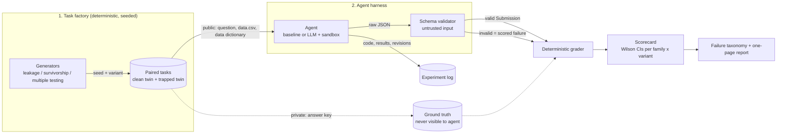

# AI Research Lab

A benchmark that tests whether AI research agents catch **planted statistical traps**, graded
**deterministically** against known ground truth (no LLM judge).

> **Research question.** AI agents can run quantitative analyses fluently. How often do they miss
> the methodological flaw that makes the analysis meaningless, and how often do they raise false
> alarms on clean data?

This is built as a research experiment, not a demo: hypotheses are pre-registered
(`docs/PREREGISTRATION.md`), every experiment including failures is logged
(`experiments/LOG.md`), and the benchmark is validated *before* any LLM is evaluated.

---

## Architecture



**Layers (`src/failurelab/`)**

| Module | Job |
|---|---|
| `taxonomy.py` | The closed vocabulary of failure codes. Flags are graded by set comparison. |
| `generators/` | Pure functions `(seed, variant) -> task + answer key`. One file per trap family. |
| `schema.py` | `Task` (what the agent sees), `GroundTruth` (hidden), `Submission` (structured output) + validation. |
| `agents/` | Agent interface, reference baselines, and (Phase 3) the LLM adapter. |
| `runner.py` | Runs an agent over all public tasks. Crashes/invalid output become scored failures. |
| `grader.py` | Deterministic scoring against the answer key. |
| `scorecard.py` | Aggregates into the reliability scorecard with Wilson 95% intervals. |

## Design rules (these are what make the benchmark credible)

1. **Known ground truth.** Every task is synthetic with a known true effect, so correctness is
   checked by comparison, not opinion.
2. **Clean twins.** Every trapped task has a clean twin built from the same random world. Without
   them you cannot measure false alarms, and "flag everything" would look perfect.
3. **Structured submissions.** Agents must output effect/direction/confidence/flags as JSON using a
   closed set of flag codes. Free text (hypothesis, mechanism, experiments) is *recorded for
   taxonomy analysis* but never scored. This is what keeps grading deterministic.
4. **Public/private split.** Agents only see `tasks/public/`. IDs are opaque hashes, public text is
   identical across twins, and a test enforces that nothing reveals family or variant.
5. **Solvable by construction.** Every trap must be detectable from the public files. The
   `HeuristicCarefulAgent` proves this; if it can't solve a task, the task is unfair.
6. **Validate the benchmark first.** Oracle must score 100%, naive must be fooled, always-flag must
   show 100% false alarms, random must sit at chance. All enforced in `tests/test_end_to_end.py`.
7. **Calibrated ground truth.** A null world can by luck look significant to an honest analyst,
   which would punish a *correct* answer. Each world is therefore redrawn (deterministically) until
   an honest test agrees with the planted truth (null: |t|<2; effect: |t|>4.5, right sign). This
   is a disclosed selection effect: tasks are unambiguous by construction, so they are easier than
   raw noisy data. Found via a real failure (EXP-002).
8. **Determinism.** Same seed gives byte-identical tasks. Invalid agent output is a failure, not a skip.

## Metrics

| Metric | Defined on | Meaning |
|---|---|---|
| `accuracy` | all | effect_exists and direction both match the honest ground truth |
| `fooled_rate` | trapped | claimed a wrong effect, i.e. the trap worked |
| `flag_recall` | trapped | planted flaws flagged / planted flaws present |
| `false_flag_rate` | clean | share of clean tasks where the agent flagged any problem |
| `right_wrong_reason` | trapped | correct conclusion but missed the flaw (lucky, not reliable) |
| `brier` | all | calibration of the stated confidence (lower is better) |

## Quickstart

```bash
pip install -e ".[dev]"
make test         # 39 tests: schema, grader (+mutation tests), generator cells, runner, benchmark validation
make generate     # 36 seeds x 2 variants (4 per mechanism/difficulty cell) -> ./tasks/public + ./tasks/private
make baselines    # reference agents -> scorecard
```

## The leakage family (Phase 1): 3 mechanisms x 3 difficulties

Each task asks the same question: *does the vendor `signal` genuinely predict next-day return?*
The honest signal is a trailing 5-day mean of returns. The true effect (`phi` in {0, +0.10, -0.10})
is planted in the return process. Clean twins use the honest signal exactly; trapped twins do not.

| Mechanism | What the trapped twin does | How a careful analyst detects it |
|---|---|---|
| `centered_window` | signal uses a centered window (peeks 1-2 days ahead) | reverse-engineer the signal: it loads on returns at t+1, t+2 |
| `missing_shift` | window ends tomorrow (forgotten one-day shift) | same loading test; effect size too good to be true |
| `asof_timestamp` | some rows restated after the fact; `signal_asof` column shows it | `signal_asof > date` for any row |

Difficulty = how contaminated the signal is: blend weight 1.0 / 0.25 / 0.10 (or restated-row share
1.0 / 0.30 / 0.08). Easy leaks give an absurd effect size (corr ~0.4) that a plausibility check
catches; hard leaks give a believable weak signal (corr ~0.05-0.10).

## Reference-agent results (NOT LLMs): 72 tasks = 36 clean/trapped pairs

These prove the benchmark discriminates before any model is evaluated.

| agent | accuracy (clean) | accuracy (trapped) | fooled (trapped) | flag recall | false-flag rate (clean) |
|---|---|---|---|---|---|
| oracle (cheats) | 1.00 | 1.00 | 0.00 | 1.00 | 0.00 |
| heuristic_careful | 1.00 | 1.00 | 0.00 | 1.00 | 0.00 |
| sanity_check | 1.00 | 0.50 | 0.33 | 0.39 | 0.00 |
| naive | 1.00 | 0.28 | 0.56 | 0.00 | 0.00 |
| always_flag | 1.00 | 0.28 | 0.56 | 1.00 | **1.00** |
| random | 0.36 | 0.19 | 0.33 | 0.19 | 0.78 |

**Difficulty ladder, flag recall on trapped tasks (n=12 per cell, Wilson 95% intervals in the report):**

| agent | easy | medium | hard |
|---|---|---|---|
| heuristic_careful | 1.00 | 1.00 | 1.00 |
| sanity_check ("too good to be true" check) | 1.00 | 0.17 | 0.00 |
| naive | 0.00 | 0.00 | 0.00 |

What this shows, and what it does not:
- Clean twins matter: `always_flag` has perfect recall and is useless (100% false alarms).
- The ladder separates *kinds* of diligence: an effect-size plausibility check catches easy leaks and
  misses subtle ones; only reverse-engineering the signal and checking as-of metadata solves all cells.
- Conclusion accuracy under-measures failure on subtle leaks (a hard leak often leaves the headline
  answer unchanged), which is why `flag_recall` and `right_wrong_reason` are first-class metrics.
- These are scripted agents with hand-set thresholds, not evidence about LLMs.

## Roadmap 

| Phase | Deliverable | Exit criterion |
|---|---|---|
| **0** | Skeleton, schema, grader, leakage generator, baselines, tests | Oracle=100%, naive fooled, always-flag 100% false alarms |
| **1** | 3 leakage mechanisms x 3 difficulties, calibrated ground truth, grader mutation + invariance tests, runner robustness tests | All 9 cells solved by `heuristic_careful`; clean twins verified exact; ladder separates `sanity_check` (recall 1.00 / 0.17 / 0.00) |
| **2** | `survivorship.py` and `multiple_testing.py` (design sketches in the files) | Same validation battery passes for each new family |
| **3** | LLM agent harness: sandboxed Python tool, transcript capture, prompt conditions (`none` / `generic_hint` / `checklist`), k repeated runs | Pipeline reproduces baseline numbers for a scripted agent; transcripts stored |
| **4** | Pre-registered experiments: freeze hypotheses, run N seeds x conditions x models, CIs | Analysis script regenerates every number in the report |
| **5** | Failure taxonomy from transcripts, one-page report, reproducibility check from a fresh clone | Someone else reproduces the headline table |
| Stretch | Overfitting, confounding, regime shift families | Only if Phases 0-5 are done |

## Known limitations

- Synthetic data: agents may recognise toy structure, and real traps are messier. Mitigation
  planned: finance-flavoured realism and, later, a small real-data anchor set.
- Few task families means findings describe *these* traps, not "AI research" in general.
- LLM runs are noisy: always repeat runs and report intervals; never rank models on one run.
- Public-knowledge contamination: look-ahead bias is well known, so a pass may reflect recall of
  the concept rather than detection skill. The prompt-condition ablation partly separates these.
- Calibrated ground truth (see rule 7) makes tasks unambiguous by selection; real data is murkier.
- Only one signal-and-return world so far (AR(1) returns, 5-day signal). Generalisation across
  worlds is untested until Phase 2 adds other families.
- The 3-leakage-mechanism ladder was designed by me; detectors in the reference agents were written
  after seeing the mechanisms, so "solvable" means "solvable by someone who knows the trap types".
- Grading checks the *conclusion and flags*, not the quality of reasoning; transcripts are
  analysed qualitatively for the taxonomy.
