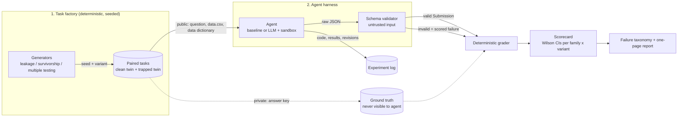
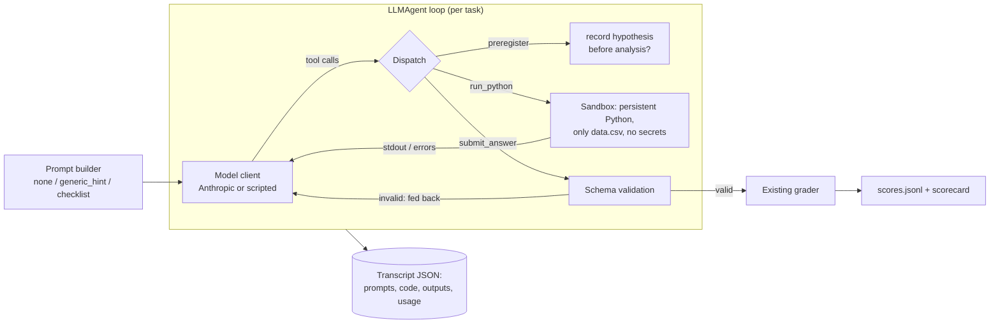
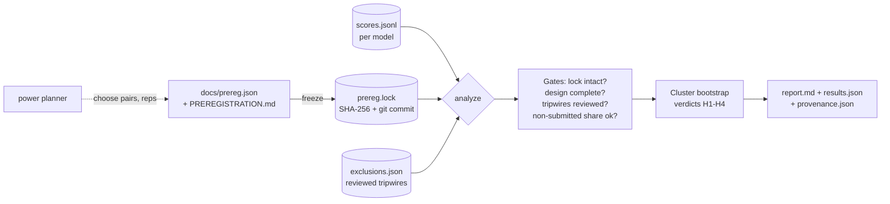

# AI Research Failure Lab

A benchmark that tests whether AI research agents catch **planted statistical traps**, graded
**deterministically** against known ground truth (no LLM judge).

> **Research question.** AI agents can run quantitative analyses fluently. How often do they miss
> the methodological flaw that makes the analysis meaningless, and how often do they raise false
> alarms on clean data?

This is built as a research experiment, not a demo: hypotheses are pre-registered
(`docs/PREREGISTRATION.md`), every experiment including failures is logged
(`experiments/LOG.md`), and the benchmark is validated *before* any LLM is evaluated.

---

## Architecture



**Layers (`src/failurelab/`)**

| Module | Job |
|---|---|
| `taxonomy.py` | The closed vocabulary of failure codes. Flags are graded by set comparison. |
| `generators/` | Pure functions `(seed, variant) -> task + answer key`. One file per trap family. |
| `schema.py` | `Task` (what the agent sees), `GroundTruth` (hidden), `Submission` (structured output) + validation. |
| `agents/` | Agent interface, reference baselines, and (Phase 3) the LLM adapter. |
| `runner.py` | Runs an agent over all public tasks. Crashes/invalid output become scored failures. |
| `grader.py` | Deterministic scoring against the answer key. |
| `scorecard.py` | Aggregates into the reliability scorecard with Wilson 95% intervals. |

## Design rules

1. **Known ground truth.** Every task is synthetic with a known true effect, so correctness is
   checked by comparison, not opinion.
2. **Clean twins.** Every trapped task has a clean twin built from the same random world. Without
   them you cannot measure false alarms, and "flag everything" would look perfect.
3. **Structured submissions.** Agents must output effect/direction/confidence/flags as JSON using a
   closed set of flag codes. Free text (hypothesis, mechanism, experiments) is *recorded for
   taxonomy analysis* but never scored. This is what keeps grading deterministic.
4. **Public/private split.** Agents only see `tasks/public/`. IDs are opaque hashes, public text is
   identical across twins, and a test enforces that nothing reveals family or variant.
5. **Solvable by construction.** Every trap must be detectable from the public files. The
   `HeuristicCarefulAgent` proves this; if it can't solve a task, the task is unfair.
6. **Validate the benchmark first.** Oracle must score 100%, naive must be fooled, always-flag must
   show 100% false alarms, random must sit at chance. All enforced in `tests/test_end_to_end.py`.
7. **Calibrated ground truth.** A null world can by luck look significant to an honest analyst,
   which would punish a *correct* answer. Each world is therefore redrawn (deterministically) until
   an honest test agrees with the planted truth (null: |t|<2; effect: |t|>4.5, right sign). This
   is a disclosed selection effect: tasks are unambiguous by construction, so they are easier than
   raw noisy data. Found via a real failure (EXP-002).
8. **Identifiability conventions.** Ground truth means *the conclusion the data can support*. For
   survivor-only data the bias is upward, so a positive effect is unidentifiable and the supported
   answer is "no effect" even when the world has one (the clean twin keeps the true answer). Each
   family states its convention in its generator docstring and in `params["truth_convention"]`.
9. **Determinism.** Same seed gives byte-identical tasks. Invalid agent output is a failure, not a skip.

## Metrics

| Metric | Defined on | Meaning |
|---|---|---|
| `accuracy` | all | effect_exists and direction both match the honest ground truth |
| `fooled_rate` | trapped | claimed a wrong effect, i.e. the trap worked |
| `flag_recall` | trapped | planted flaws flagged / planted flaws present |
| `false_flag_rate` | clean | share of clean tasks where the agent flagged any problem |
| `right_wrong_reason` | trapped | correct conclusion but missed the flaw (lucky, not reliable) |
| `brier` | all | calibration of the stated confidence (lower is better) |

## Quickstart

```bash
pip install -e ".[dev]"
make test         # 134 tests: schema, grader (+mutation tests), 3 generators x every cell, runner, sandbox, harness, statistics, analysis, taxonomy tooling, reproducibility
make generate     # 36 seeds x 2 variants x 3 families = 216 tasks (~170 MB; use --n 18 for lighter) -> ./tasks/public + ./tasks/private
make baselines    # reference agents -> scorecard
make selftest     # scripted model through the full LLM harness (no API key)
```

## The leakage family (Phase 1): 3 mechanisms x 3 difficulties

Each task asks the same question: *does the vendor `signal` genuinely predict next-day return?*
The honest signal is a trailing 5-day mean of returns. The true effect (`phi` in {0, +0.10, -0.10})
is planted in the return process. Clean twins use the honest signal exactly; trapped twins do not.

| Mechanism | What the trapped twin does | How a careful analyst detects it |
|---|---|---|
| `centered_window` | signal uses a centered window (peeks 1-2 days ahead) | reverse-engineer the signal: it loads on returns at t+1, t+2 |
| `missing_shift` | window ends tomorrow (forgotten one-day shift) | same loading test; effect size too good to be true |
| `asof_timestamp` | some rows restated after the fact; `signal_asof` column shows it | `signal_asof > date` for any row |

Difficulty = how contaminated the signal is: blend weight 1.0 / 0.25 / 0.10 (or restated-row share
1.0 / 0.30 / 0.08). Easy leaks give an absurd effect size (corr ~0.4) that a plausibility check
catches; hard leaks give a believable weak signal (corr ~0.05-0.10).

## Leakage results (reference agents, NOT LLMs): 72 tasks = 36 clean/trapped pairs

These prove the benchmark discriminates before any model is evaluated.

| agent | accuracy (clean) | accuracy (trapped) | fooled (trapped) | flag recall | false-flag rate (clean) |
|---|---|---|---|---|---|
| oracle (cheats) | 1.00 | 1.00 | 0.00 | 1.00 | 0.00 |
| heuristic_careful | 1.00 | 1.00 | 0.00 | 1.00 | 0.00 |
| sanity_check | 1.00 | 0.50 | 0.33 | 0.39 | 0.00 |
| naive | 1.00 | 0.28 | 0.56 | 0.00 | 0.00 |
| always_flag | 1.00 | 0.28 | 0.56 | 1.00 | **1.00** |
| random | 0.36 | 0.19 | 0.33 | 0.19 | 0.78 |

**Difficulty ladder, flag recall on trapped tasks (n=12 per cell, Wilson 95% intervals in the report):**

| agent | easy | medium | hard |
|---|---|---|---|
| heuristic_careful | 1.00 | 1.00 | 1.00 |
| sanity_check ("too good to be true" check) | 1.00 | 0.17 | 0.00 |
| naive | 0.00 | 0.00 | 0.00 |

What this shows, and what it does not:
- Clean twins matter: `always_flag` has perfect recall and is useless (100% false alarms).
- The ladder separates *kinds* of diligence: an effect-size plausibility check catches easy leaks and
  misses subtle ones; only reverse-engineering the signal and checking as-of metadata solves all cells.
- Conclusion accuracy under-measures failure on subtle leaks (a hard leak often leaves the headline
  answer unchanged), which is why `flag_recall` and `right_wrong_reason` are first-class metrics.
- These are scripted agents with hand-set thresholds, not evidence about LLMs.

## Phase 2 families: survivorship and multiple testing

Same validation battery as leakage: clean twins as exact negative controls, calibrated truth, public
text identical across twins, a solvability proof, and tests per cell. 6 cells per family.

**Survivorship** (question: is the universe's average daily return different from zero?)

| Mechanism | Trapped twin | Cue for a careful analyst | Difficulty |
|---|---|---|---|
| `survivor_only_panel` | only names alive at the end (names are delisted after a -40% cumulative return) | zero attrition in a panel the vendor says covers every name; `status` column with no delistings; gaps in sequential ids | easy: all three cues; medium: id gaps (+ balance); hard: balance only |
| `backfilled_membership` | vendor backfilled history before each stock joined an index | rows dated before `index_add_date` | backfill length 60 / 30 / 10 days (bias shrinks, cue stays) |

Truth conventions: in `survivor_only_panel` the supported answer is always "no effect" (bias is
upward, so a positive effect is unidentifiable; worlds with a negative effect are excluded because
survivorship erases a negative drift, which I verified by simulation, see EXP-004). In
`backfilled_membership` filtering to member rows recovers the clean data, so the true effect (any
sign) is the answer.

**Multiple testing** (question: does the research desk's signal genuinely predict next-day return?)

| Mechanism | Trapped twin | Cue | Difficulty |
|---|---|---|---|
| `visible_candidates` | M signal columns delivered, true one at a random position | count the columns, correct for M tests | M = 200 / 40 / 12 |
| `hidden_winner` | only the best-looking signal delivered, plus `library_size` = M | read `library_size`, correct for M tests | M = 200 / 40 / 12 |

The clean twin is one pre-specified signal. Honest analysis is a Bonferroni-corrected test over the M
signals searched. Naive failure is NOT conditioned on: it is whatever chance produces, and it falls
as M shrinks because a smaller search throws up fewer seductive false positives.

### Reference results for Phase 2 (n = 36 pairs per family; scripted agents, NOT LLMs)

| agent | family | accuracy (trapped) | fooled | flag recall | false-flag rate (clean) |
|---|---|---|---|---|---|
| oracle (cheats) | both | 1.00 | 0.00 | 1.00 | 0.00 |
| heuristic_careful | both | 1.00 | 0.00 | 1.00 | 0.00 |
| sanity_check (cheap checks) | survivorship | 0.83 | 0.17 | 0.83 | 0.00 |
| sanity_check (cheap checks) | multiple testing | 0.83 | 0.17 | 0.50 | 0.00 |
| naive | survivorship | 0.31 | 0.64 | 0.00 | 0.00 |
| naive | multiple testing | 0.67 | 0.33 | 0.00 | 0.00 |
| always_flag | both | 0.31 / 0.67 | 0.64 / 0.33 | 1.00 | **1.00** |

Cheap-checks agent, flag recall by cell (n = 6 per cell, so read these as pass/fail on a design
check, not as rates):

| cell | recall | why |
|---|---|---|
| survivor_only_panel: easy, medium | 1.00 | explicit cues (status column, id gaps) |
| survivor_only_panel: hard | 0.00 | only cue is a balanced panel with zero attrition |
| backfilled_membership: all | 1.00 | the `index_add_date` column is cheap to check |
| visible_candidates: all | 1.00 | the column count is visible |
| hidden_winner: all | 0.00 | requires reading the `library_size` metadata |

Reading these honestly: the Phase 2 ladders are about *what kind of attention* catches the trap
(visible vs metadata vs inference from absence), not smooth difficulty. Whether LLM agents track
this pattern is the Phase 3/4 question.

## Phase 3: the LLM agent harness



| Piece | What it does |
|---|---|
| `sandbox.py` | Persistent Python session per task; workdir holds only `data.csv`; scrubbed env (no API keys); timeout, memory cap, output truncation; `failurelab` imports blocked. A convenience boundary, not a security boundary. |
| `prompts.py` | Three conditions that differ only by an appended block. `checklist` names all six taxonomy items for every task, so it never reveals which trap is present. |
| `agents/llm_agent.py` | Tool loop with `preregister`, `run_python`, `submit_answer`; schema errors are fed back (up to 2 retries); every run saves a full transcript; completed tasks are reused on re-run. |
| `llm.py` | `AnthropicClient`, `BudgetedClient` (hard call cap), `ScriptedClient` (fake model for tests). Budget exhaustion and API outages raise `RunAborted`, which stops the run and is never scored as an agent failure. |
| `experiment.py` | Rep x condition loops, balanced clean/trapped pair selection, `scores.jsonl`. |

Outcomes recorded per run: `submitted`, `invalid_format`, `no_submission`, `max_turns`. Process facts
(preregistered before running code? how many cells? tripwire hits? token usage) are logged but not scored.

**What was verified (offline, with a scripted model):** the Phase 3 exit test runs a scripted model through
the entire loop (real sandbox, real tool dispatch, validation, grading) on 36 tasks across all three
families and reproduces the direct baseline scores exactly for two agents. Sandbox isolation, resume,
abort-vs-score handling, format retries and the select/plan logic have their own tests.
**What was NOT verified:** any real LLM run. `AnthropicClient` is only tested against a fake SDK object.
Use `docs/RUNNING_EXPERIMENTS.md` (smoke test first).

Disclosed design choices that are threats to validity:
- The base prompt explains the scoring rule (false flags count against you) so recall cannot be inflated by
  flag-spamming; and every task question already says "flag any methodological problems you find". So the
  `none` condition measures detection when asked to look, not unprompted discovery.
- The base prompt defines `effect_exists` as "supported after correcting for problems you identify", which
  the survivorship convention requires.
- Reps are not independent draws; Phase 4 will cluster by task.

## Phase 4: pre-registered analysis



| Piece | What it does |
|---|---|
| `prereg.py` + `docs/prereg.json` | Machine-readable plan with explicit decision rules; `freeze` validates and writes a hash lock. Changing either file afterwards makes the analysis NON-CONFIRMATORY. |
| `inference.py` | Cluster bootstrap over clean/trapped pairs (task, twin, all reps and conditions), common random numbers for paired contrasts. Treating runs as independent would give intervals far too narrow. |
| `study.py` | Gates, verdicts (`supported` / `falsified` / `inconclusive`), exploratory tables, data-quality and sensitivity tables, report. Numbers in the report are registered when computed and the text is scanned for unregistered numbers. |
| `power.py` | Simulates experiments with assumed rates and applies the same decision rules, so the sample size is justified before any money is spent. |

What the tests establish (all offline): planted effects are detected across seeds and a real effect is never called
falsified; a null checklist effect is never called supported; a checklist that buys recall with false alarms is not
supported; every gate (frozen lock, completeness, tripwire review, non-submitted share) changes the status; output is
byte-for-byte reproducible; a hand-typed number in the report is rejected; and the whole pipeline runs on real
`scores.jsonl` produced by the harness. Bootstrap interval coverage is checked on clustered synthetic data.

What is NOT established: any result about real LLMs. No live experiment has been run. The reports used in tests are
generated from synthetic scores with planted rates and must never be presented as findings.

## Phase 5: taxonomy tooling, one-pager, reproducibility

| Piece | What it does |
|---|---|
| `behavior.py` | Per run: did the agent's code look at the cue that exposes the flaw, and did it flag it? Diagnoses: detected / saw_not_flagged / never_looked / flagged_without_looking. The cue detector is a keyword heuristic, tested on labelled code snippets and meant to be audited by hand. |
| `coding.py` | Stratified sampling of failures with inverse-probability weights, readable transcripts, blank coding sheet, per-code Cohen's kappa between coders, detector-vs-human validity, weighted code prevalence with task-clustered intervals. Seed codes are a-priori hypotheses; the taxonomy comes from reading transcripts. |
| `onepager.py` | One-page summary. Computed numbers come from the results files; the author's interpretation is checked so every number in it exists in those files; length is capped. |
| `repro.py` | Task-set manifest, task regeneration check, regrade of every raw submission against the answer keys, byte-for-byte analysis reproduction. |

Workflow in `docs/CODING_GUIDE.md`. **No taxonomy exists yet**: it requires real transcripts. Tests use scripted agents and
synthetic scores only. numpy's random streams are not guaranteed across major versions, so publish the generated task set
with its manifest rather than relying on regeneration.

## Roadmap

| Phase | Deliverable | Exit criterion |
|---|---|---|
| **0 (done)** | Skeleton, schema, grader, leakage generator, baselines, tests | Oracle=100%, naive fooled, always-flag 100% false alarms |
| **1 (done)** | 3 leakage mechanisms x 3 difficulties, calibrated ground truth, grader mutation + invariance tests, runner robustness tests | All 9 cells solved by `heuristic_careful`; clean twins verified exact; ladder separates `sanity_check` (recall 1.00 / 0.17 / 0.00) |
| **2 (done)** | `survivorship.py` and `multiple_testing.py`, 2 mechanisms x 3 difficulties each, schema-based reference solvers (`analysis.py`) | `heuristic_careful` solves all 21 cells with 0 false alarms; oracle 100%; always-flag 100% false alarms; 57 tests |
| **3 (done, offline-verified)** | LLM agent harness: sandboxed Python tool, transcript capture, prompt conditions (`none` / `generic_hint` / `checklist`), k repeated runs, resumable, budget-capped | Scripted model through the full harness reproduces baseline scores exactly on 36 tasks; transcripts stored. **A live-model smoke test is still yours to run.** |
| **4 (tooling done; live runs are yours)** | Freeze lock, power planner, task-clustered bootstrap analysis, gated report | Analysis regenerates every number in the report byte-for-byte; every gate tested; **no live results exist yet** |
| **5 (tooling done; taxonomy needs real transcripts)** | Behaviour diagnosis, coding pipeline, one-pager, reproducibility checks | Tooling tested offline; someone else reproduces the headline table via `repro-check` once live results exist |
| Stretch | Overfitting, confounding, regime shift families | Only if Phases 0-5 are done |

## Known limitations

- Synthetic data: agents may recognise toy structure, and real traps are messier. Mitigation
  planned: finance-flavoured realism and, later, a small real-data anchor set.
- Few task families means findings describe *these* traps, not "AI research" in general.
- LLM runs are noisy: always repeat runs and report intervals; never rank models on one run.
- Public-knowledge contamination: look-ahead bias is well known, so a pass may reflect recall of
  the concept rather than detection skill. The prompt-condition ablation partly separates these.
- Calibrated ground truth (see rule 7) makes tasks unambiguous by selection; real data is murkier.
- Each family is one synthetic world (AR(1) returns for leakage, iid returns with a delisting
  barrier for survivorship, Gaussian signals for multiple testing). Real traps are messier.
- Survivorship conventions are stated assumptions (see above); only upward-bias worlds are modelled.
- Multiple testing uses a normal-approximation Bonferroni threshold on pooled correlations.
- The sandbox is not a security boundary (see `docs/RUNNING_EXPERIMENTS.md`); the tripwire is for review only.
- 6 tasks per cell is a design check, not a statistic; headline claims need the Phase 4 sample sizes.
- The 3-leakage-mechanism ladder was designed by me; detectors in the reference agents were written
  after seeing the mechanisms, so "solvable" means "solvable by someone who knows the trap types".
- Grading checks the *conclusion and flags*, not the quality of reasoning; transcripts are
  analysed qualitatively for the taxonomy.
